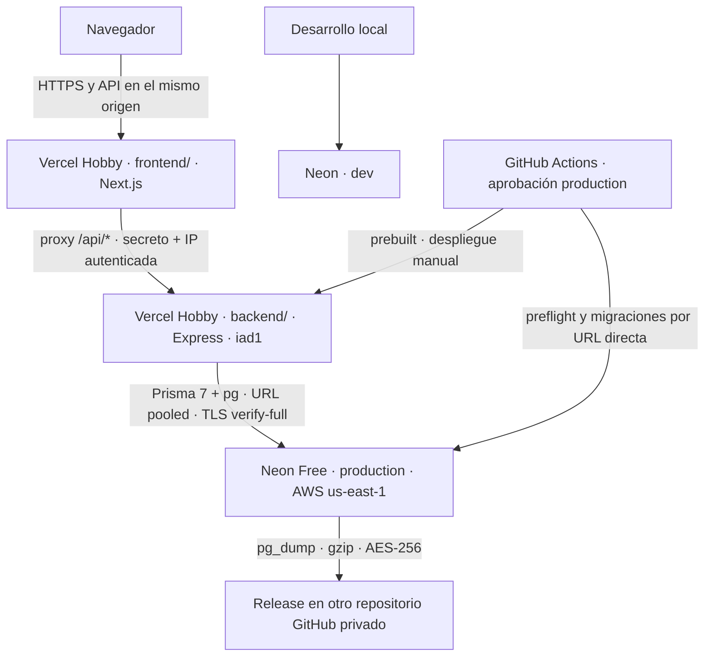

# Despliegue de FinTrack OS

## Decisión vigente y estado

**Decisión del Owner, 2026-10-19:** dos proyectos **Vercel Hobby** (raíces `frontend/` y `backend/`) y **Neon Free**. Beta gratuita para familiares y amigos, con registro abierto. Sin tarjeta ni servicios de pago. Google Payments bloqueó la facturación (`OR-CBAT-14`): Cloud Run, Artifact Registry y Google Cloud Storage quedan fuera del despliegue activo. El proyecto Google Cloud `fintrack-os-499319` se conserva **solo para Google OAuth**.

Este documento prepara la configuración; no afirma que se hayan creado cuentas, recursos, backups o despliegues reales. Las pruebas locales no sustituyen el primer smoke en Vercel. El trabajo legal sigue aplazado y no forma parte de esta migración.

## 1. Arquitectura



| Componente | Configuración |
|---|---|
| Frontend | Proyecto Vercel propio, Root Directory `frontend/`, preset Next.js, Node 24 |
| Backend | Segundo proyecto, Root Directory `backend/`, preset **Other**, Node 24, Fluid compute, `iad1` |
| Base | Neon Free, AWS `us-east-1`, rama `production` para producción y `dev` para local |
| Backups | Assets cifrados de Releases en `Juanm0331123/FinTrack-OS-backups`, **privado** |
| CI | GitHub Actions; no despliega automáticamente el backend |

No se agregan Railway ni Render. Los dominios gratuitos de Vercel tienen HTTPS administrado; no hay certificado que comprar o cargar manualmente. Las dos ramas de Neon comparten los recursos del mismo proyecto.

## 2. Compatibilidad y límites verificados

Fuentes oficiales consultadas el **2026-10-19**. Revisarlas antes de habilitar producción: los proveedores pueden cambiarlas.

| Aspecto | Confirmación y decisión |
|---|---|
| Express | Vercel admite entradas `app`, `index` o `server` en raíz o `src`, exportación por defecto o `listen`; `express.static` se ignora. Para evitar escoger entre `src/app.ts` y `src/server.ts`, aquí se fuerza **`framework: null` y una única función `api/index.ts`**, con rewrite de todas las rutas. [Express](https://vercel.com/docs/frameworks/backend/express) |
| Node/ESM | Node **24.x** está soportado y es el predeterminado vigente; Vercel gestiona sus parches. La app sigue con imports `.ts` y `type: module`. [Versiones](https://vercel.com/docs/functions/runtimes/node-js/node-js-versions) |
| TypeScript | El runtime Node admite `/api/*.ts` y configuración `tsconfig.json`. El builder oficial usa TypeScript; `rewriteRelativeImportExtensions: true` reescribe los imports relativos `.ts` al emitir JS. Se conserva el código fuente y una regresión local comprueba la emisión de `../src/app.js`. No se ha ejecutado un build remoto real con una cuenta Vercel. [Runtime Node](https://vercel.com/docs/functions/runtimes/node-js), [builder oficial](https://github.com/vercel/vercel/blob/main/packages/node/src/build.ts), [compilación del builder](https://github.com/vercel/vercel/blob/main/packages/node/src/typescript.ts) |
| Fluid compute | Reutiliza instancias y admite concurrencia. Pool global de módulo con `attachDatabasePool` de **`@vercel/functions` 3.10.1**, única dependencia nueva: gestiona conexiones ociosas al suspenderse la instancia. No se cierra el pool por petición. [Fluid](https://vercel.com/docs/fluid-compute), [pooling oficial](https://vercel.com/kb/guide/connection-pooling-with-functions) |
| Función | Hobby con Fluid permite hasta **300 s**; FinTrack configura **35 s**, con presupuesto HTTP propio de 30 s. Bundle máximo descomprimido **250 MB**. Una región predeterminada `iad1`, fijada explícitamente cerca de Neon. [Límites](https://vercel.com/docs/functions/limitations), [regiones](https://vercel.com/docs/functions/configuring-functions/region) |
| Cuotas Hobby | 4 CPU-h, 360 GB-h de memoria, 1 millón de invocaciones, 100 GB de transferencia y 10 GB de transferencia de origen. Son cuotas del plan, **no se duplican por tener dos proyectos**; el proxy añade trabajo e invocaciones. [Hobby](https://vercel.com/docs/plans/hobby) |
| Costo | Hobby es personal/no comercial. Al agotar cuotas normalmente se pausa el recurso hasta renovar el período (generalmente 30 días); no es disponibilidad continua garantizada. Mantener Hobby, sin tarjeta, sin prueba Pro ni complementos de pago. [Hobby](https://vercel.com/docs/plans/hobby), [uso permitido](https://vercel.com/docs/limits/fair-use-guidelines) |
| Neon Free | **1 GB por proyecto**, **100 CU-h al mes por proyecto**, suspensión tras 5 min inactivo y restauración limitada a hasta 6 h o 1 GB de cambios. Sin tarjeta. `production` y `dev` comparten presupuesto. [Precios Neon](https://neon.com/pricing) |
| SMTP | Vercel bloquea el puerto 25, **465/587 están abiertos**. Gmail usa Nodemailer con envío esperado antes de responder y timeouts; comprobar credenciales, latencia y entrega reales. La alternativa HTTP `EMAIL_PROVIDER=resend` existe sin SDK nuevo, pero necesita remitente/dominio verificado para destinatarios arbitrarios; no sustituye automáticamente Gmail sin verificar un dominio. [Correo en Vercel](https://vercel.com/kb/guide/sending-emails-from-an-application-on-vercel) |
| Backups GitHub | Cada asset debe ser **menor de 2 GiB**. GitHub no fija tamaño total máximo por Release; no equivale a almacenamiento ilimitado garantizado ni exime las políticas de uso. Retención propia de 90 días. [Releases](https://docs.github.com/en/repositories/releasing-projects-on-github/about-releases) |

La configuración de `regions`, `functions.maxDuration`, `fluid`, comandos y `framework` está en [`backend/vercel.json`](../backend/vercel.json), según [vercel.json](https://vercel.com/docs/project-configuration/vercel-json). `git.deploymentEnabled: false` deshabilita despliegues Git de **todas las ramas** del backend; no la CLI autorizada. [Configuración Git](https://vercel.com/docs/project-configuration/git-configuration).

## 3. Sesiones, proxy e IP real

El navegador llama únicamente a `https://<frontend>.vercel.app/api/*` con credenciales. `frontend/src/proxy.ts` reenvía al backend. Aunque ambos terminen en `vercel.app`, sus hostnames son sitios distintos: no exponer directamente el backend como URL del cliente.

- Refresh en cookie **HttpOnly, Secure, SameSite=Lax**, sin `Domain`: ligada al hostname frontend. Access token solo en memoria, nunca en almacenamiento web.
- La lista blanca del proxy elimina cabeceras propias enviadas por un visitante y establece `x-fintrack-edge-auth` y `x-fintrack-client-ip`.
- Solo cuando la plataforma inyecta **`VERCEL=1`**, el frontend acepta un `X-Forwarded-For` de **una IP válida** fijada por Vercel. Una lista, IP inválida o ausencia falla con 503; no elige el primer valor de una cadena ni acepta `X-Real-IP` alternativo. Fuera de Vercel no confía en esas cabeceras. [Cabeceras de Vercel](https://vercel.com/docs/headers/request-headers#x-forwarded-for).
- Backend: **`TRUST_PROXY=false`**. No se cuentan los dos saltos y no se afirma que `req.ip` sea el visitante: la IP autenticada vive en `req.clientIp`, que usan logs y límites. Solo admite esa identidad con secreto válido. Sin secreto, negocio devuelve **403 `EDGE_PROXY_REQUIRED`**, incluso en el dominio público backend.
- `/api/health/live` y `/api/health/ready` son públicos: live no consulta la base; ready consulta con plazo de 2 s y comparte el resultado durante 2 s. No devuelven credenciales ni SQL.
- Ambos dominios estables de producción deben permitir acceso de red público. Una protección de autenticación Vercel que redirija el backend impediría proxy y smoke. La autorización de negocio sigue en la app; no se configura un bypass que llegue al navegador.

El secreto bloquea negocio directo; no evita que un rechazo consuma recursos. Revisar uso/403/429, pausar el proyecto ante abuso y rotar el secreto en **ambos** proyectos. Registro abierto no significa acceso exclusivamente por invitación.

## 4. Entrada, pool y ciclo de vida

`backend/api/index.ts` exporta Express sin abrir puerto ni instalar señales de cierre. No importa `src/server.ts`. Local/Docker siguen usando este último con `pnpm dev`/`pnpm start` y cierre SIGTERM/SIGINT. Las Functions no dependen de señales ni temporizadores persistentes; los logs estructurados salen a stdout.

El build ejecuta `pnpm prisma:generate` e incluye el cliente generado; **no migra**. `DATABASE_URL`: URL **pooled** Neon (`-pooler`), **`sslmode=verify-full`**, no `require`. Pool: `DB_POOL_MAX=2`, `DB_IDLE_TIMEOUT_MS=5000`, `DB_STARTUP_TIMEOUTS=false`. Vercel decide cuántas instancias abre: **2 conexiones por instancia no es un tope global**.

Mantener `DB_CONNECTION_TIMEOUT_MS=5000`, `DB_LOCK_TIMEOUT_MS=3000`, `DB_STATEMENT_TIMEOUT_MS=8000`, `DB_TRANSACTION_TIMEOUT_MS=10000`. Transacciones usan `SET LOCAL`; el pooler rechaza parámetros de arranque. Para consultas sueltas, un administrador debe configurar defaults del rol runtime por conexión directa (pendiente del Owner, no ejecutado por esta tarea):

```sql
ALTER ROLE <rol_runtime> SET statement_timeout = '8s';
ALTER ROLE <rol_runtime> SET lock_timeout = '3s';
ALTER ROLE <rol_runtime> SET idle_in_transaction_session_timeout = '10s';
```

Usar rol separado para migraciones, con DDL y sin esos límites cortos. No ejecutar placeholders ni cambiar roles de producción para pruebas locales.

## 5. Variables exactas por lugar

Reemplazar `<...>` en los paneles; nunca son credenciales para copiar literalmente. Los `.env.example` son de desarrollo: **no subir `.env` ni copiar sus valores inseguros a producción**. No compartir secretos Production con Preview/Development. Cambiar variables requiere nuevo despliegue.

### Proyecto frontend — Environment: Production

| Variable | Valor |
|---|---|
| `NEXT_PUBLIC_BACKEND_URL` | `https://<frontend>.vercel.app`, mismo origen público del frontend |
| `NEXT_PUBLIC_SITE_URL` | `https://<frontend>.vercel.app`, sin ruta ni barra final |
| `BACKEND_ORIGIN` | `https://<backend>.vercel.app`, alias estable, no URL de un deployment particular |
| `EDGE_PROXY_SECRET` | Aleatorio ≥ 32 caracteres, idéntico al backend; **solo servidor** |

No poner URL Neon, contraseñas, JWT, secretos OAuth ni `GCP_*` en frontend. La plataforma gestiona `VERCEL` y `NODE_ENV`.

### Proyecto backend — Environment: Production

| Variable | Valor |
|---|---|
| `NODE_ENV` | `production` |
| `DATABASE_URL` | URL **pooled**, rama **production**, `sslmode=verify-full` |
| `ALLOWED_ORIGINS` | `https://<frontend>.vercel.app`, sin barra final |
| `FRONTEND_APP_URL` | `https://<frontend>.vercel.app` |
| `TRUST_PROXY` | `false` |
| `EDGE_PROXY_SECRET` | Mismo secreto del frontend |
| `JWT_ACCESS_SECRET`, `JWT_REFRESH_SECRET` | Dos secretos largos aleatorios, distintos entre sí y de desarrollo |
| `JWT_ACCESS_TTL`, `JWT_REFRESH_TTL`, `SESSION_ABSOLUTE_TTL` | `15m`, `7d`, `30d` |
| `COOKIE_SECURE`, `COOKIE_SAME_SITE` | `true`, `lax` |
| `COOKIE_DOMAIN` | No crear o dejar vacía |
| `EXPOSE_DEV_AUTH_TOKENS` | `false` |
| `DB_POOL_MAX`, `DB_IDLE_TIMEOUT_MS`, `DB_STARTUP_TIMEOUTS` | `2`, `5000`, `false` |
| `DB_CONNECTION_TIMEOUT_MS`, `DB_LOCK_TIMEOUT_MS` | `5000`, `3000` |
| `DB_STATEMENT_TIMEOUT_MS`, `DB_TRANSACTION_TIMEOUT_MS` | `8000`, `10000` |
| `REQUEST_TIMEOUT_MS`, `JSON_BODY_LIMIT` | `30000`, `1mb` |
| `EMAIL_PROVIDER` | `gmail` |
| `EMAIL_FROM` | `FinTrack OS <fintrackos.auth@gmail.com>` |
| `EMAIL_PASSWORD` | Contraseña de aplicación Gmail, no contraseña normal de la cuenta |
| `EMAIL_REPLY_TO` | Opcional: `fintrackos.auth@gmail.com` |
| `EMAIL_SEND_TIMEOUT_MS`, `OAUTH_HTTP_TIMEOUT_MS` | `10000`, `8000` |
| `GOOGLE_OAUTH_CLIENT_ID`, `GOOGLE_OAUTH_CLIENT_SECRET` | Credenciales del cliente web de producción en el proyecto Google existente |
| `GOOGLE_OAUTH_CALLBACK_URL` | `https://<frontend>.vercel.app/api/auth/oauth/google/callback` |
| `GITHUB_OAUTH_CLIENT_ID`, `GITHUB_OAUTH_CLIENT_SECRET` | Credenciales de la app OAuth GitHub de producción |
| `GITHUB_OAUTH_CALLBACK_URL` | `https://<frontend>.vercel.app/api/auth/oauth/github/callback` |

No definir manualmente `VERCEL` ni `PORT`; no cargar `DIRECT_URL` en runtime Vercel. Las demás variables (rate limits, emisor/audiencias, retención y TTL de códigos) conservan los defaults descritos en [`backend/.env.example`](../backend/.env.example). No desactivar límites para evitar un 429 de pruebas.

Alternativa de correo, solo con dominio verificado: `EMAIL_PROVIDER=resend`, `RESEND_API_KEY` y un `EMAIL_FROM` autorizado; quitar `EMAIL_PASSWORD`. Usa el `fetch` HTTP existente. No exige otro paquete npm; el dominio y las condiciones gratuitas del proveedor deben resolverse antes. Gmail sigue siendo la configuración inicial sin compra de dominio.

### GitHub principal — Environment: `production`

**Secrets** (no Variables):

| Nombre exacto | Uso |
|---|---|
| `VERCEL_TOKEN` | Token Vercel con acceso al scope Hobby del Owner |
| `VERCEL_ORG_ID` | ID del scope que expone el proyecto |
| `VERCEL_PROJECT_ID_BACKEND` | ID `prj_…` del backend, no el del frontend |
| `PRODUCTION_DIRECT_URL` | URL **directa**, sin `-pooler`, production, TLS `verify-full`, rol migrador; también cleanup-auth |
| `PRODUCTION_BACKUP_URL` | URL **directa** para pg_dump; rol lector con acceso a todos los datos/tablas necesarios |
| `BACKUP_PASSPHRASE` | Frase aleatoria independiente ≥ 32 caracteres, recomendado 40 o más, copia fuera de GitHub |
| `BACKUP_REPO_TOKEN` | PAT fine-grained solo para repo privado backups: **Contents read/write**, Metadata read |

**Environment Variables** (no Secrets):

| Nombre exacto | Valor |
|---|---|
| `BACKEND_PRODUCTION_URL` | `https://<backend>.vercel.app`, alias estable que verifica el smoke |
| `BACKUP_REPO` | `Juanm0331123/FinTrack-OS-backups` o nombre privado elegido |

No hacen falta secretos GCP, buckets, cuentas de servicio ni Workload Identity Federation. El token de backups no tiene acceso a todo el GitHub del Owner ni permisos de workflows/administración.

## 6. Guía del Owner: configurar sin desplegar antes de migrar

Estos son **pasos futuros para el Owner**, no acciones ejecutadas por el agente. Antes, el código debe estar revisado, versionado e integrado en `main`, con CI verde.

### A. Cuenta y proyectos vacíos

1. En [Vercel Signup](https://vercel.com/signup), elegir **Continue with GitHub** y la cuenta correcta. Mantener scope personal/Hobby: no activar Pro trial ni introducir tarjeta.
2. Para que backend **no se publique con Import → Deploy**, crear proyectos vacíos con CLI oficial. Desde la raíz `FinTrack-OS`, ejecutar por separado:

   ```powershell
   pnpm dlx vercel@64.7.0 login
   pnpm dlx vercel@64.7.0 project create fintrack-os-backend
   pnpm dlx vercel@64.7.0 project create fintrack-os-frontend
   ```

   Elegir el mismo scope Hobby. `project create` no crea un deployment; `add` es su alias. [Comando oficial](https://vercel.com/docs/cli/project#create).
3. Dashboard → backend → **Settings → Build and Deployment**: Root Directory **`backend`**, Framework Preset **Other**, Node **24.x**. No sustituir por Express autodetectado. `backend/vercel.json` aporta install `pnpm install --frozen-lockfile`, build `pnpm prisma:generate`, Fluid, región y duración. No usar `pnpm start` como build.
4. Frontend: raíz **`frontend`**, Framework **Next.js**, Node **24.x**, install `pnpm install --frozen-lockfile`, build `pnpm build`.
5. Settings → Domains de ambos: confirmar/reservar alias gratuitos estables y anotar hostnames reales. El nombre deseado puede estar ocupado: no usar el ejemplo si Vercel asigna otro.
6. Mantener backend **sin Git conectado** antes del primer deploy. Sus futuros despliegues Git también quedan bloqueados por `git.deploymentEnabled=false`. **No pulsar Deploy/Redeploy backend en Dashboard**: el primero también pasa por workflow y migraciones.

### B. Variables, OAuth y base

1. Neon: comprobar AWS `us-east-1`, ramas **production/dev**; pooled para runtime, directa para migración/backup de la rama correcta. QA local nunca usa production.
2. Vercel → cada proyecto → Settings → Environment Variables: cargar las tablas anteriores, **solo Production**. Guardar secretos como sensibles si el panel lo ofrece. Generar criptográficamente los tres secretos independientes (borde, JWT access y JWT refresh).
3. Producción HTTPS, sin `COOKIE_DOMAIN`. `NEXT_PUBLIC_BACKEND_URL` es el frontend; el backend remoto solo va en `BACKEND_ORIGIN` del servidor.
4. Google Auth Platform, proyecto **`fintrack-os-499319`**, cliente web existente: origen frontend y callback exacto de la tabla. No habilitar Cloud Run/AR/GCS ni facturación. Si OAuth sigue en Testing, añadir usuarios de prueba: registro abierto de la app no elimina restricciones de Google.
5. GitHub → Settings → Developer settings → OAuth Apps: homepage frontend y callback GitHub de la tabla; guardar credenciales en backend Production.
6. Gmail: activar dos pasos y crear contraseña de aplicación para Nodemailer; guardar solo en backend. Probar recepción real después de desplegar, no solo aceptación del proveedor.

### C. IDs y token Vercel

1. Backend → Settings → General: copiar **Project ID** (`prj_…`) a `VERCEL_PROJECT_ID_BACKEND`.
2. Copiar el ID del scope/cuenta del proyecto a `VERCEL_ORG_ID`. Alternativa desde raíz monorepo: `pnpm dlx vercel@64.7.0 link --project fintrack-os-backend`, seleccionar scope y leer `projectId`/`orgId` de `.vercel/project.json`. **Link no despliega**. No subir `.vercel/` ni configuración descargada: está ignorada. [Monorepos/CLI](https://vercel.com/docs/monorepos#add-a-monorepo-through-vercel-cli).
3. [Vercel → Account Settings → Tokens](https://vercel.com/account/tokens): crear token limitado al scope del Owner, con vencimiento; guardarlo como `VERCEL_TOKEN` y planificar renovación. No ponerlo en frontend/backend ni comandos visibles/logs.

### D. Repo privado backups y token

1. GitHub → New repository → `FinTrack-OS-backups`, **Private**, inicializar README para tener commit/rama. No guardar secretos ni dumps en el historial Git.
2. No activar **immutable releases**: el flujo necesita borrar backups de más de 90 días. Mantener siempre privado.
3. GitHub → Settings → Developer settings → Personal access tokens → **Fine-grained tokens** → Generate. Resource owner: Owner. Repository access: **Only select repositories**, únicamente backups.
4. Permissions: **Contents: Read and write**, Metadata: Read implícito. Sin Administration, Actions ni otros repos. Fijar vencimiento/renovación; guardar como `BACKUP_REPO_TOKEN` en environment del principal.
5. Generar `BACKUP_PASSPHRASE` fuera de GitHub y conservar otra copia segura; perderla hace irrecuperables dumps existentes. No reutilizar como JWT/proxy.

### E. GitHub `production` con aprobación

1. Repo principal → Settings → Environments → New environment → **`production`**.
2. **Required reviewers**: Owner o revisor autorizado. Si Owner es único revisor y dispara el flujo, **no activar Prevent self-review**, que impediría su aprobación. Con otro revisor disponible puede exigirse aprobación independiente.
3. Deployment branches and tags → Selected branches and tags → solo **`main`**, sin tags/otras ramas. Deshabilitar bypass de administradores si el panel lo permite.
4. Cargar siete Secrets y dos Variables de las tablas **dentro del environment**, no en backups.
5. GitHub Free soporta revisión y environment secrets para repos **públicos**, como el principal; no trasladar workflow a backups privado esperando igual protección gratuita. [Reglas oficiales](https://docs.github.com/en/actions/reference/workflows-and-actions/deployments-and-environments).

### F. Primer despliegue, en orden

1. CI verde en `main` revisado; configurar ambos proyectos/variables, environment, URLs, OAuth y backups sin publicar backend.
2. Si production tiene datos, ejecutar antes **Backup cifrado de la base (manual)** desde `main`, aprobar y comprobar Release privado. Si está vacía, preflight admite primer despliegue; no ejecutar resets para prepararla.
3. Actions → **Deploy backend (manual)** → Run workflow → **main** → **`DESPLEGAR`**. Aprobar environment. Orden automático: instalar, generar, typecheck/tests, preflight solo lectura, **migrate deploy**, build, deploy y smoke.
4. Confirmar alias backend `/api/health/ready` 200 y `/api/auth/me` sin secreto 403. Smoke no envía secreto.
5. Publicar frontend enlazando su proyecto al repo GitHub, raíz `frontend/`, producción `main`, variables ya guardadas. Solo frontend puede usar despliegue Git automático. Backend exclusivamente manual. No cambiar a URLs temporales de un deployment.
6. Probar desde frontend registro/verificación, login, refresh, logout, recuperación, Google/GitHub, hoja y Deudas. Confirmar IP por visitante/rate limits sin guardar tokens en logs.
7. Ejecutar backup real y **restauración aislada**; solo después considerar activar cron semanal, hoy comentado.

## 7. Flujos y migraciones de producción

[`deploy-backend.yml`](../.github/workflows/deploy-backend.yml): solo `workflow_dispatch`, **DESPLEGAR**, **main**. Environment obliga a aprobar antes de entregar secretos. CLI **64.7.0**, fijada según [release notes](https://vercel.com/docs/cli/release-notes), no `latest`.

Orden: instalar → `prisma generate` → typecheck → tests → `scripts/check-migration-conflicts.ts` con `PRODUCTION_DIRECT_URL` → `prisma migrate deploy` directa → `vercel pull --environment=production` → `vercel build --prod` → `vercel deploy --prebuilt --prod` → smoke. Los tres comandos Vercel se ejecutan desde **raíz del monorepo**, tomando Root Directory `backend` del proyecto; no desde `backend/` con raíz duplicada. `.vercel/` descargada se elimina al terminar.

Nunca ejecutar `migrate dev`, `db push`, `reset` ni tests en producción. El build del proveedor no migra. Deploy/backup comparten `fintrack-production-database` para no migrar durante dump/cleanup.

Si migra pero falla build/deploy, la base puede tener esquema nuevo: **no hay rollback automático**. Preferir migraciones aditivas compatibles y corregir/reintentar workflow. No restaurar production a ciegas ni volver a backend incompatible. Volver a función/imagen anterior no revierte datos.

## 8. Backups cifrados y restauración

[`backup-db.yml`](../.github/workflows/backup-db.yml) sigue **manual**, cron comentado. Antes de leer la base comprueba otro repo **privado** con commit inicial. `postgres:18 pg_dump --format=custom` → gzip → GPG **AES-256**. Solo persiste cifrado y SHA-256: nunca dump claro ni artifact del repo público. La URL directa del backup admite `sslmode=verify-full`, `sslrootcert=system` y `channel_binding`; el flujo separa host, puerto, usuario, contraseña y nombre antes de llamar a libpq, no transmite una URI en `PGDATABASE`. Usa las CA del sistema con `PGSSLROOTCERT=system`. La frase se pasa por descriptor, no argumento visible. [Conexiones TLS y CA en PostgreSQL](https://www.postgresql.org/docs/current/libpq-connect.html#LIBPQ-CONNECT-SSLROOTCERT).

Sube ambos assets a un Release draft y publica **dentro del repo privado** tras completarlos. Borra Releases gestionados por el flujo publicados hace más de 90 días, según `published_at` (no la antigüedad del commit al que apunta el tag). La retención se aplica cuando corre backup: mientras cron esté comentado, Owner debe ejecutarlo o limpiar manualmente. Revisar drafts fallidos. No poner datos en commits/tags, notas, logs ni nombres.

Tras backup exitoso, `cleanup-auth` usa `PRODUCTION_DIRECT_URL` y `scripts/cleanup-auth.ts`: conserva retención actual de sesiones, tokens, contadores y último marcador vigente de cuentas pendientes. No purga datos financieros.

### Ensayo de restauración: siempre fuera de production

1. Descargar `.dump.gz.gpg`/`.sha256` del repo privado con sesión autorizada (`gh release download <tag> --repo <repo-privado>`). Verificar SHA-256 antes de descifrar.
2. Crear rama temporal **vacía y aislada** o PostgreSQL local aislado compatible con PostgreSQL 18. Comprobar hostname/nombre dos veces. Una rama copiada desde production ya contiene datos: elegir destino vacío o reemplazarlos **solo allí**. Nunca usar la URL de production.
3. Introducir por separado los datos del destino directo y aislado (host **sin `-pooler`**, usuario, nombre de base y contraseña). `PGDATABASE` debe contener **solo el nombre de la base**, nunca una URI. No escribir dump claro en disco ni contraseña en argv:

   ```bash
   set -euo pipefail
   read -rp 'Host directo del destino AISLADO (sin -pooler): ' PGHOST
   read -rp 'Usuario del destino AISLADO: ' PGUSER
   read -rp 'Nombre de la base AISLADA (no una URL): ' PGDATABASE
   read -rsp 'Contraseña del destino AISLADO: ' PGPASSWORD; echo
   read -rsp 'Frase del backup: ' RESTORE_PASSPHRASE; echo
   export PGHOST PGUSER PGDATABASE PGPASSWORD
   export PGPORT=5432 PGSSLMODE=verify-full PGSSLROOTCERT=system PGCONNECT_TIMEOUT=15
   # Revisar destino antes de continuar. FILE es el fichero cifrado descargado.
   gpg --batch --pinentry-mode loopback --passphrase-fd 3 3<<<"$RESTORE_PASSPHRASE" \
       --decrypt "$FILE" \
       | gzip -d \
       | docker run --rm -i -e PGHOST -e PGPORT -e PGUSER -e PGDATABASE \
           -e PGPASSWORD -e PGSSLMODE -e PGSSLROOTCERT -e PGCONNECT_TIMEOUT postgres:18 \
           pg_restore --dbname="$PGDATABASE" --single-transaction \
               --exit-on-error --no-owner --no-privileges
   unset PGHOST PGPORT PGUSER PGDATABASE PGPASSWORD PGSSLMODE PGSSLROOTCERT PGCONNECT_TIMEOUT RESTORE_PASSPHRASE
   ```

4. Comprobar `_prisma_migrations`, conteos de usuarios/meses/filas/bolsillos/deudas, claves foráneas y recorrido de app de prueba. Al comparar con origen, usar el instante del backup: escrituras posteriores cambian cifras legítimamente.
5. Registrar fecha, Release, destino aislado y resultado sin datos personales. Borrar solo recursos temporales propios. Backup subido **no demuestra** restauración válida.

## 9. Costo y operación

- Mantener Hobby/Free sin tarjeta, sin trial Pro/add-ons/upgrades. Al cobrar en futuro hará falta otro plan; hoy no se decide esa migración.
- Revisar Usage de ambos proyectos y Neon; no duplicar cuotas Vercel ni de ramas Neon. `/api` pasa por dos proyectos; también consumen rechazos, salud y builds.
- Evitar pings frecuentes a readiness: despiertan Neon e impiden suspensión consumiendo CU-h. Usar pruebas puntuales/logs.
- Pool limitado por instancia; observar conexiones/colas/503 antes de ampliar. Rate limiter PostgreSQL sigue compartido entre instancias; no reemplazar por memoria para serverless.
- Runtime Logs muestran JSON stdout; revisar códigos/requestId sin cookies, claves, OTP o dumps. Hobby tiene retención corta; capturar incidentes saneados.
- Renovar tokens antes de vencer y secreto de proxy coordinadamente; guardar copia segura de frase backup fuera de GitHub.
- Gmail: puerto abierto no garantiza entrega, ausencia de cold starts o disponibilidad de cuota del proveedor.

## 10. Pendiente en el primer entorno real

- [ ] Hobby sin tarjeta, raíces/presets correctos, backend Git deshabilitado y `production` con aprobación/main.
- [ ] Prebuilt real resuelve ESM `.ts`, incluye Prisma, bundle < 250 MB, Node 24/Fluid/`iad1`.
- [ ] Migraciones controladas; live/ready 200; negocio directo sin secreto 403, sin redirección de autenticación Vercel.
- [ ] HTTPS válido; cookie `Secure; HttpOnly; SameSite=Lax`, sin Domain, vía frontend; refresh dos pestañas/logout.
- [ ] IP por visitante; XFF y `x-fintrack-*` falsas no cambian identidad/límites; ausencia de IP canónica falla cerrada.
- [ ] Neon pooled/direct correctas, certificado real `verify-full`, timeouts por rol; cold starts/concurrencia moderada.
- [ ] Recepción real Gmail y callbacks Google/GitHub; errores/timeout sin diagnósticos internos.
- [ ] Backup privado cifrado, SHA-256, retención y restauración aislada aprobados antes del cron.
- [ ] Cuotas/disponibilidad aceptables durante beta; ningún mecanismo de pago activado.

Los resultados locales pertenecen al reporte y sus salidas reales; leer documentación o pasar CI no marca estas casillas externas.

## 11. Alternativa no activa: Docker / Cloud Run

Se conservan `backend/Dockerfile`, `backend/scripts/docker-smoke.sh` y job Docker CI: migraciones, TLS, usuario no root, salud y SIGTERM. Alternativa portable si Google resuelve facturación y Owner aprueba retomarla. **No se usan ahora** Cloud Run, Artifact Registry ni GCS; no crear recursos, presupuestos, cuentas de servicio o secretos. Google OAuth existente es independiente del bloqueo.
